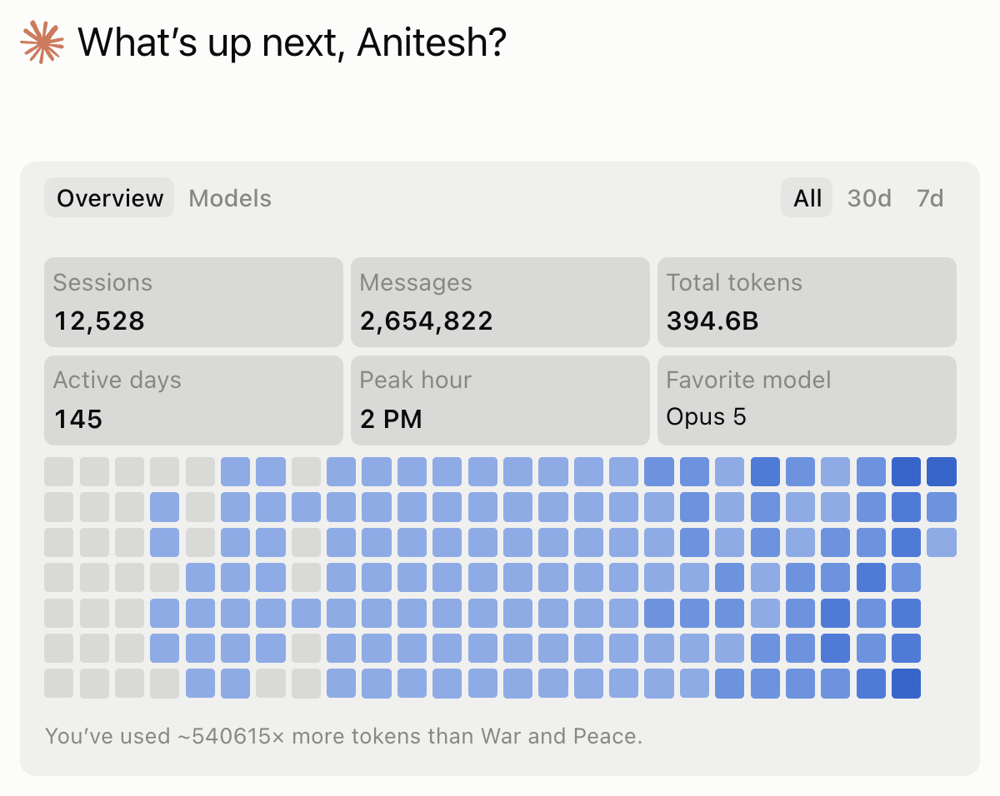

# claude-token-policy

**Your Claude Code bill is context size × number of calls, not the model you picked.**

This is the token policy our small team runs Claude Code under, packaged as a plugin: a skill
the model follows, hooks that enforce the rules by machine, and a census script that measures
your transcripts so you can check the claim against your own usage.



One founder's account, as the Claude app counts it: 145 active days, 394.6B tokens.

That headline is about 2.4 times the real figure. Claude Code writes one reply as several lines
(its thinking, its text, each tool call), and the app's total matches counting a reply's tokens
once for every line. Over the last 30 days the app shows 133.4B. Counting every line of every
transcript gives 133.0B. Counting each reply once, as our census does, gives 55.6B. Scaled the
same way, the all-time figure is roughly 165B. Either way, about 97% of it was Claude re-reading
its own context. This repo is what we did about it.

The squares count messages per day, not tokens (hover one: 4 August shows 20,441). They darken
after 5 September, when the policy began: we moved work off the top tier onto Opus and Sonnet
and ran more calls a day, each carrying a third less context, for slightly less money per day.

## What we measured

We read every local Claude Code transcript from the three weeks before the policy and the five
and a half weeks after it.

**Before:** 97.6% of all tokens processed were the session re-reading its own history. The
words a human typed were 0.02%. 70% of subagent dispatches named no model and inherited the
parent's, often the most expensive tier.

**After:**

| Measure | Change |
|---|---|
| **Average context per model call** | **240k → 165k (31% smaller)** |
| Model calls per day (a rough proxy for work done) | 32% more |
| Cost per day (API-equivalent) | 7% lower |
| Cost per call | $0.19 → $0.13 (29% lower) |
| Subagent dispatches with no model named | 70% → 4% (the 4% go to agents whose files pin their model) |
| Sessions that went past 400k context | 96% fewer |
| Largest single context | 963k → 330k |
| Share of tokens on the top tier | 26% → ~12%, and zero top-tier subagents |
| Cost lost to idle-then-resume, per day | 53% lower |
| Repeat reads of the same file, per day | 20% fewer |
| Fixed setup before the first word (system prompt, tools, skills, memory) | 49k → 42k |

We did a third more work per day for slightly less money, because each call carried a third
less context. The per-call context figure does not depend on prices, so it is the most reliable
number in the table; the dollar figures use API list prices as a yardstick (a subscription
does not bill them).

**Correction, 13 October.** Our census read every session in a symlinked project folder twice
(the symlinks date from 8 August), and added each subagent's compactions to its parent session.
Over the last 30 days that made its totals about 1.8 times too high. Both windows in this table
were counted with the same fault, so its ratios and percentage changes should hold; we cannot
re-run the "before" window, because those transcripts are gone. An earlier version of this page
said the longest sessions reached 70 and 104 compactions; the true figure is 31. The census is
fixed and tested.

### What did not move, or got worse

- **The re-read share stayed at ~97%.** That is how prompt caching works, and the policy never
  tried to change it. It made each re-read smaller instead. 97% re-reads is not 97% waste.
- **Marathon sessions got longer.** We had told long-running sessions to carry on from one
  task to the next instead of rebooting. The longest then compacted 31 times. Each call was
  cheap, but the sessions never ended. We added a rule: replace a session after its fourth compaction, at the
  next natural break. The plugin warns on it. We will publish the re-measure.
- **The most re-read file in any session was our own memory index.** Shared, frequently
  edited files get re-read by design; budget for them.

## The learning curve

The policy came out of our own mistakes.

| When | What happened | What it became |
|---|---|---|
| Until 5 Sep | No policy. Seven in ten subagents named no model and inherited the parent's, often the top tier. One call carried 963k of context. | Every dispatch names its tier; the top tier is never a subagent |
| 15 Aug to 5 Sep | Big sessions left idle past an hour re-wrote their whole context on the next prompt, at the cache-write price. | Do not park a big session and come back |
| 5 Sep | We measured those three weeks: 97.6% of tokens were re-reads; 0.02% were typed by a human. | Context is the bill; work inside 200k |
| 5 Sep to mid Oct | Context per call fell from 240k to 165k. But sessions told to carry on between tasks became marathons; the longest compacted 31 times. | Replace a session after its fourth compaction |
| Mid Oct | Most of our August transcripts were gone from disk, so the "before" half can no longer be re-run from the files. Claude Code clears old transcripts on its own (see `cleanupPeriodDays`). | Save the census output the day you run it |
| 13 Oct | Checking the screenshot above against our census turned up two things: the app's total matches counting a reply once per line it is written in, and our census read every session in a symlinked folder twice. Ratios should hold; totals did not. | Count each reply once, read each file once, and check any headline total against a second count |

## The four rules

1. **Context is the bill. Work inside 200k.** A 1M window is opt-in, for a stated reason.
2. **Do not park a big session and come back.** An idle hour loses the cache; the next prompt
   re-writes the whole context.
3. **Every dispatch names its tier.** Judgement → strong; mechanical → fast; ordinary building
   → a fast-tier build agent with a written brief; the top tier is never a subagent.
4. **Read once.** Then search and read ranges. Subagents return summaries, not transcripts.

The full policy, including who builds what, review sizing and long-session rules, is in
[POLICY.md](POLICY.md).

## Requirements

- Claude Code with plugin support and the `PreCompact` and `SessionStart` hook events
  (any 2026 release). Tested on macOS and Linux; the hooks call `python3`, so on Windows make
  sure that name resolves.
- Python 3.9 or newer. The hooks and the census use the standard library only.
- `jq`, only for the optional status line.

## Install

```
/plugin marketplace add aniteshdharam/claude-token-policy
/plugin install token-policy@claude-token-policy
```

Then copy the keys you want from [examples/settings.json](examples/settings.json) into
`~/.claude/settings.json` ([what each key does](examples/README-settings.md)). If you copy a
single line, make it `"CLAUDE_CODE_SUBAGENT_MODEL": "opus"` under `env`: it stops unnamed
subagents from inheriting the top tier.

## What is in the box

| Piece | What it does |
|---|---|
| `skills/token-policy` | The rules, written for the model, loaded when it dispatches, forks, reads large files or plans a long session |
| `hooks/dispatch_guard.py` | Refuses top-tier subagents, forks from the top tier and forks above 100k context; tells the model what to do instead |
| `hooks/read_guard.py` | Warns on re-reading a file already read this session, and on reading a large file whole. Never blocks |
| `hooks/turn_guard.py` | Warns before an idle-then-resume cache rewrite, and as context grows towards compaction |
| `hooks/precompact_checkpoint.py` + `session_start_checkpoint.py` | Saves the working state before compaction, re-injects it after, counts compactions and warns after the fourth |
| `agents/builder.md` | A fast-tier, build-only agent for ordinary building |
| `scripts/token_census.py` + `/token-census` | Reads your local transcripts and prints the census: spend by tier, largest sessions, re-reads, unnamed dispatches, cache rewrites |
| `scripts/statusline.sh` | Shows context in absolute tokens, red past 200k |

The checkpoint hooks write `~/.claude/checkpoints/<session>.md`: the session's opening brief,
its latest instruction, recent narrative, file paths and shell commands. It stays on your
machine and is deleted after 7 days, but treat it like your transcripts: a secret typed into a
command line will be in it.

Hooks default to enforcing. Set `TOKEN_POLICY_MODE=warn` to turn every refusal into a warning
while you try it out. Thresholds are environment variables; see `hooks/_config.py`.

### Which tier is "top" for you

The defaults assume three tiers: a top tier the hooks keep out of subagents (`fable`), a
strong tier for judgement (`opus`) and a fast tier for mechanical work (`sonnet`). If the most
expensive model you can run is Opus, shift everything down one step in the `env` block:

```json
"TOKEN_POLICY_TOP_TIER": "opus",
"TOKEN_POLICY_DEFAULT_MODEL": "sonnet",
"CLAUDE_CODE_SUBAGENT_MODEL": "sonnet"
```

Then Opus stays in the main session, and every unnamed subagent runs on Sonnet.

## Measure yourself first

Before installing anything, run the census on your own last three weeks:

```
git clone https://github.com/aniteshdharam/claude-token-policy
python3 claude-token-policy/scripts/token_census.py
```

It reads `~/.claude/projects` locally and sends nothing anywhere; `--since YYYY-MM-DD` widens
or narrows the window. The console output names your sessions by their titles; add
`--no-titles` for output you mean to share. The dollar column uses a price table at the top
of the script, with the date it was last checked printed in the output; edit it if your
provider's page differs. If your re-read share, unnamed-dispatch share or
largest-context figure looks like ours did, the policy will pay off.

## Tests

```
python3 -m unittest discover -s tests -v
```

Every hook, and the census, is run as a subprocess with sample input in a throwaway folder, so
the tests touch nothing of yours. They run in CI on every push.

## License

MIT
